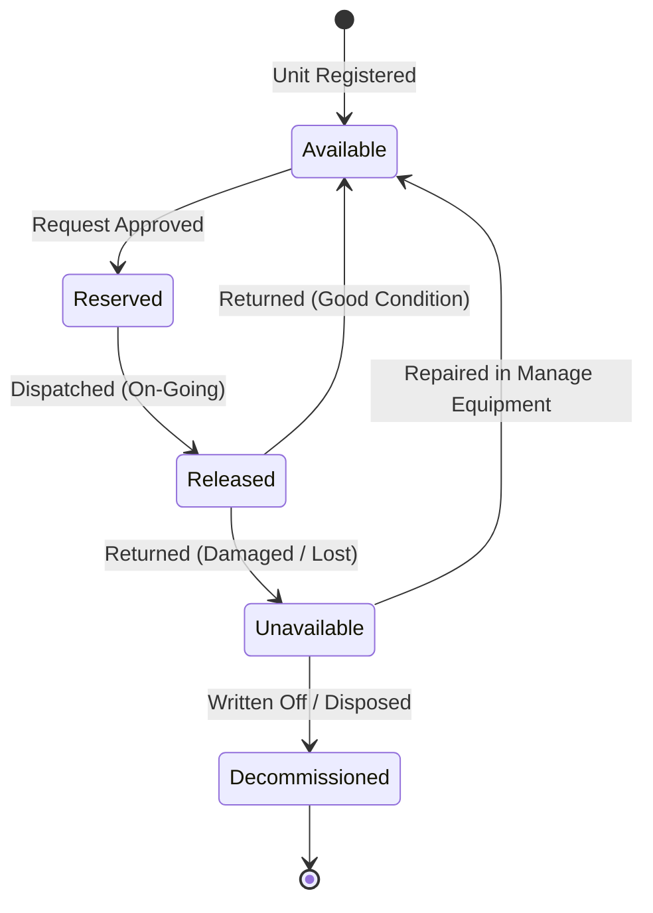

# Father Saturnino Urios University (FSUU)
## Automated Venue Reservation & Equipment Borrowing Management System
# Operational & System Maintenance Runbook (`MAINTENANCE.md`)

**Document Version:** 1.0.0  
**Target Audience:** AVR Custodians, Student Assistants, System Administrators, and DevOps Maintainers.  
**Companion Documents:** [`SYSTEM_DOCUMENTATION.md`](./SYSTEM_DOCUMENTATION.md) · [`README.md`](./README.md)

---

## 1. Daily Operational Maintenance (Frontline Custodians & Staff)

Custodians and Student Assistants should execute these checks at the beginning and end of each operating shift.

### 1.1 Morning Opening Checklist
1. **Log in to Staff Portal:** Verify access to the **Dashboard**, **Venue Bookings**, **Equipment Borrowings**, and **Reports**.
2. **Review Today's Reservations:** Check the **Today's Reservations** widget on the dashboard for:
   - Approved venue reservations requiring room unlock and equipment staging.
   - Approved equipment borrowing requests scheduled for counter pickup.
3. **Check for Unclaimed / No-Show Bookings:**
   - The system automatically marks bookings as expired or auto-released if requestors fail to claim them within grace periods defined in *Operating Hours*. Verify that no stale locks remain.

### 1.2 On-Going Loans & Unit Assignment Tagging
1. **Verify Physical Unit Tagging ("Not Tagged" Check):**
   - Open **Reports $\rightarrow$ Equipment Out Tab**.
   - If any active loan shows **"Pending unit assignment"** (or was marked on-going before scanning a barcode), open the loan modal in **Equipment Borrowings** and assign the exact physical barcode or serial number.
   - *Why this matters:* Assigning the exact unit ensures that specific device cannot be accidentally double-borrowed and guarantees full traceability if damaged.
2. **Releasing Equipment:**
   - Always confirm pre-release inspection condition with the borrower.
   - Click **Release Equipment (Mark On-Going)** only when handing physical units to the borrower.

### 1.3 Overdue Loan Management & Reminders
1. **Identify Overdue Loans:**
   - On the **Equipment Borrowings** list or **Equipment Out Tab**, overdue items are flagged with red badges showing overdue duration (e.g., `Overdue 45m`).
2. **Dispatch Automated Return Reminders:**
   - Open the borrowing detail modal.
   - Click **Return Equipment (Send via SMS & Email)**, or choose **SMS only** / **Email only**.
   - The borrower will receive immediate notification with their tracking reference number.

### 1.4 Evening Turnover & Return Inspection
1. **Conduct Post-Use Inspection:**
   - Verify every individual unit against its checklist.
   - Inspect cables, power adapters, and bundled built-in accessories.
2. **Record Condition Accurately:**
   - **Good:** Select `✓ Complete`. The unit will automatically return to **Available** stock.
   - **Damaged:** Select `Damaged` and input required incident notes. The unit will automatically transition to **Unavailable** and be locked from future bookings.
   - **Lost:** Select `Lost`. The item is marked **Lost** and immediately counted in the lost inventory report.
3. **Capture Evidence Photos:**
   - For any Damaged or Lost incident, attach inspection photos using the built-in photo uploader.

---

## 2. Equipment Lifecycle & Inventory Management

Equipment is managed through two primary interfaces:
- **`Manage Equipments`:** The master registry for creating categories, adding physical units, editing specifications, tracking lifespans, and performing administrative repairs.
- **`Reports $\rightarrow$ Stock by Category & Physical Units`:** The live operational dashboard reflecting real-time availability across campus.



### 2.1 Repair & Restocking Workflow (Restoring Broken Units)
When a unit was previously flagged as `Damaged` or `Under Repair` during an inspection, follow this procedure once the item is repaired:
1. Navigate to **Manage Equipment**.
2. Locate the parent category (e.g., *Epson Projector EB-X06*) and expand its **Physical Units** table.
3. Find the repaired unit by Barcode or Serial Number.
4. Click the **Edit / Action** menu for that unit:
   - Change **Condition** to `Good`.
   - Change **Status** to `Available`.
   - Update maintenance notes if applicable.
5. Save changes.
   - The system immediately clears the damage flag, increments the category's **Available** count by +1, and broadcasts an update to all open client sessions.

### 2.2 Decommissioning & Disposal of Lost / Unusable Assets
If an asset is stolen, irreparably destroyed, or decommissioned:
1. In **Manage Equipment**, select the physical unit.
2. Change status to `Decommissioned` or delete the unit row if writing off.
3. Adjust the category's **Total Quantity** to reflect the new institutional baseline.

### 2.3 Managing Built-in Bundles & Kit Packages
Certain units have child components (e.g., an AVR Sound System that bundles 2 wireless microphones and an audio receiver):
- **Healthy Parent Unit:** If parent and all built-in children are `Good`, the parent unit counts as **1 Available kit**.
- **Damaged Child Component:** If any child accessory is marked `Damaged` or `Lost`, the parent unit automatically moves to **Unavailable** to prevent checking out an incomplete kit.
- **Dispatched Together:** When a parent kit is marked `On-Going`, all bundled built-in children automatically transition to `Released` status.

### 2.4 Monitoring Equipment Lifespan & Procurement Planning
In **Manage Equipment**, every physical unit tracks:
- **Date Purchased:** Acquisition date.
- **Lifespan (Years):** Manufacturer's expected operational lifecycle.
- **Lifespan vs Current:** Visual progress indicator showing remaining operational life.
- *Quarterly Task:* Custodians should filter units nearing 100% lifespan to prepare budget and procurement requests for the upcoming academic year.

---

## 3. Data Synchronization & Cache Clearing

The system utilizes an automatic real-time synchronization engine between **Equipment Borrowing**, **Venue Booking**, and **Inventory Reports**.

### 3.1 How Stock Recalculation Operates
- Whenever a booking transitions to `on-going`, `completed`, or has physical barcodes assigned, the backend triggers:
  1. `EquipmentCategoryService::autoSyncUnitConditions()`: Matches active barcodes and serial numbers across both Venue Bookings and Borrowings.
  2. `EquipmentCategoryService::syncCategoryStock()`: Recalculates `Total`, `Available`, `Released`, `Reserved`, `Damaged`, and `Lost`.
  3. `InventoryStockUpdated`: Emits a WebSocket broadcast to update all connected dashboards without requiring a browser reload.

### 3.2 Troubleshooting Stale Display ("Browser Cache")
If a user reports seeing outdated numbers on a client device:
1. The system automatically includes cache-busting timestamp queries (`?_t=Date.now()`).
2. If stubborn browser caching persists, click the **Refresh** button on the **Stock by Category** tab. This executes:
   ```javascript
   invalidateCache("equipment_units");
   invalidateCache("equipment_types_list");
   ```
3. Alternatively, have the user perform a hard browser refresh:
   - **Windows:** `Ctrl + F5`
   - **Mac:** `Cmd + Shift + R`

---

## 4. Academic Term Rollover (End of Semester / Term)

At the conclusion of each academic trimester or semester, the system administrator must perform the term transition.

### 4.1 Rollover Procedure
1. **Ensure All Active Loans Are Concluded:**
   - Verify that all active equipment borrowings and venue bookings for the ending term are returned and inspected.
   - Address any outstanding unreturned or damaged equipment with departmental filers.
2. **Access Academic Terms Management:**
   - Navigate to **Settings $\rightarrow$ Academic Terms** (or database table `academic_terms`).
3. **Activate the New Term:**
   - Create the upcoming term (e.g., *AY 2026-2027 2nd Trimester*).
   - Set `is_active = 1` on the new term. The previous term automatically becomes inactive.
4. **Export End-of-Term Reports:**
   - Navigate to **Reports**.
   - Use **Export to Excel** or **Export to PDF** on:
     - *Equipment Stock Report (Master Audit)*
     - *Equipment Out / Incident Log*
     - *Department Usage Summary*
   - Archive exported spreadsheets for institutional auditing.

---

## 5. Technical Maintenance & Deployment (Developers & Sysadmins)

### 5.1 Rebuilding and Deploying Frontend Changes
Whenever source code in `frontend/src` is modified, the production distribution bundle served by Laravel must be regenerated:

```powershell
# 1. Navigate to frontend and compile production bundle
cd "c:\Booking system\frontend"
npm run build

# 2. Synchronize compiled assets to Laravel public directory
powershell -Command "Copy-Item -Path 'frontend/dist/*' -Destination 'backend/public/' -Recurse -Force"
```

### 5.2 Clearing Backend Application Caches
If configuration, routes, or database schemas are altered:
```powershell
cd "c:\Booking system\backend"

# Clear all Laravel caches
php artisan optimize:clear

# Re-cache configuration for production performance (optional)
php artisan config:cache
php artisan route:cache
```

### 5.3 Database Backup Procedure
Perform automated daily or weekly MySQL database dumps:
```powershell
# Replace credentials with your database configuration
mysqldump -u root -p fsuu > "c:\Booking system\backend\database\backups\fsuu_backup_$(Get-Date -Format 'yyyyMMdd_HHmmss').sql"
```

### 5.4 Verifying Scheduled & Background Workers
Ensure background schedulers and email/SMS queues are operating:
```powershell
# Test scheduled tasks (No-show auto releases, overdue alerts)
php artisan schedule:run

# Inspect queue status (if using database or redis queue driver)
php artisan queue:work --stop-when-empty
```

---

## 6. Common Troubleshooting Quick-Reference

| Issue | Probable Cause | Action / Resolution |
| :--- | :--- | :--- |
| **Stock shows fewer Available than physically on shelf** | Ongoing loans exist with untagged units, or a unit is marked Damaged. | Check **Reports $\rightarrow$ Equipment Out Tab** for active loans. Check **Manage Equipment** for units flagged as *Damaged* or *Under Repair*. |
| **Cannot assign a unit barcode in borrowing modal** | Unit is already reserved or assigned to another booking in overlapping time. | Check schedule conflict warning. Choose another healthy unit or adjust schedule. |
| **Built-in accessories do not show in modal** | Serial number lookup was disconnected or unit has unlinked children. | Ensure parent unit has valid child unit IDs listed under `built_in_units` in *Manage Equipment*. |
| **Borrower did not receive return reminder email** | Invalid recipient email or mail driver rate limit. | Use the **Resend Email** button in the loan modal; check mail server credentials in `.env`. |
| **Changes made in code don't appear in browser** | Production bundle not rebuilt. | Run `npm run build` in `frontend/` and copy `dist/` to `backend/public/`. |
